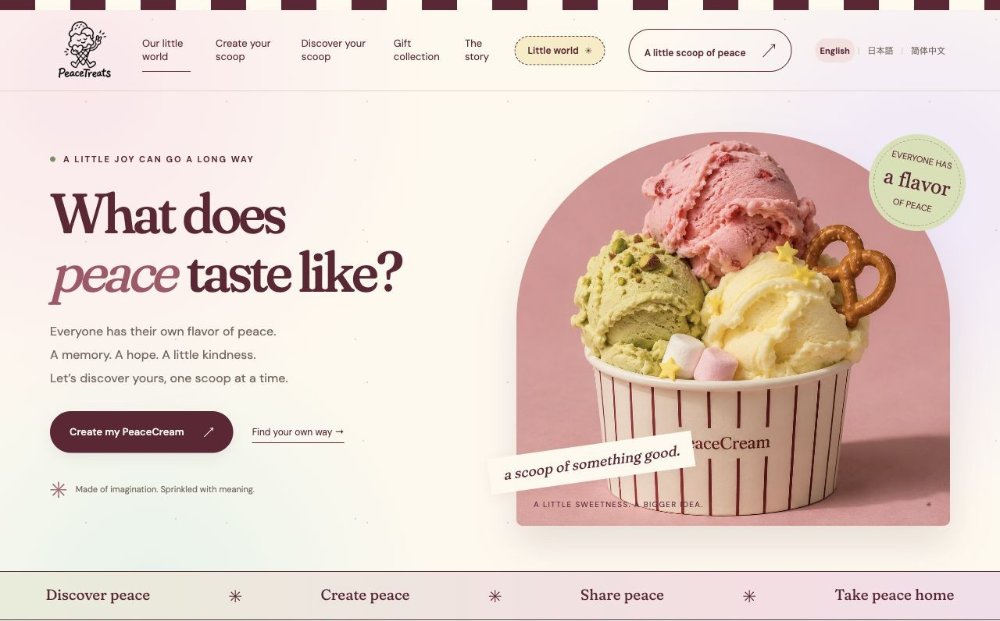
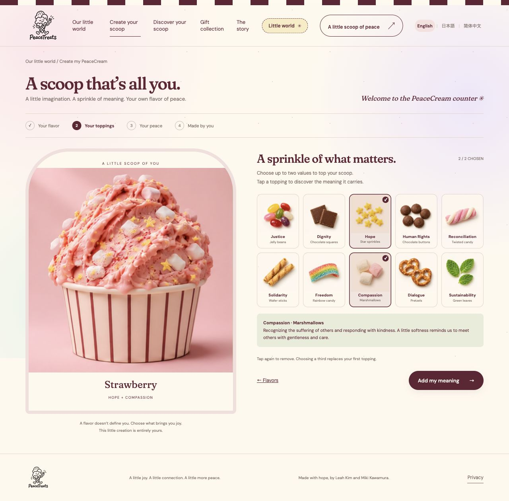
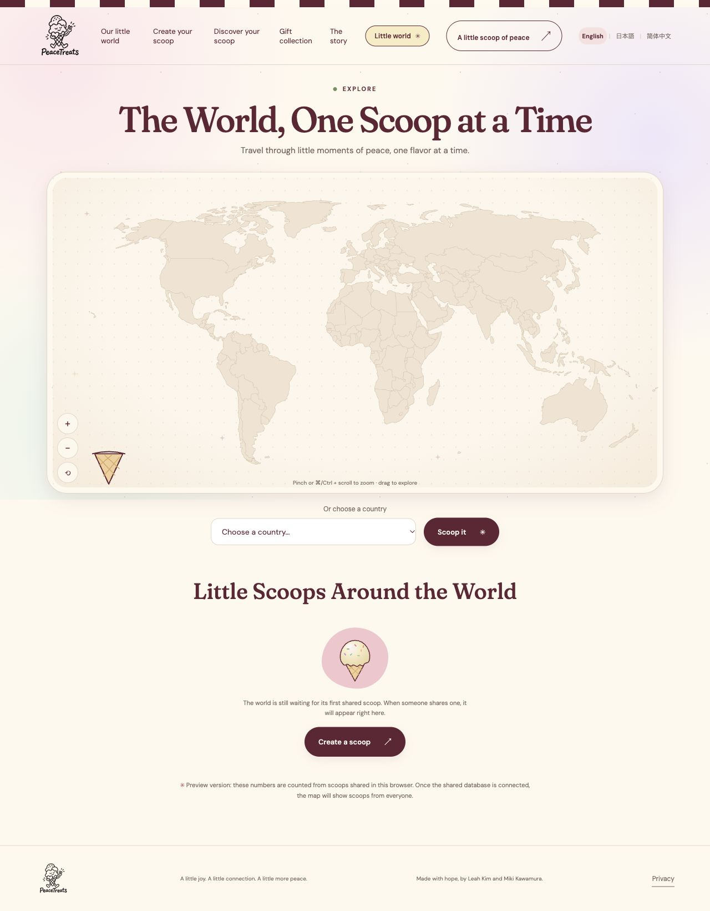
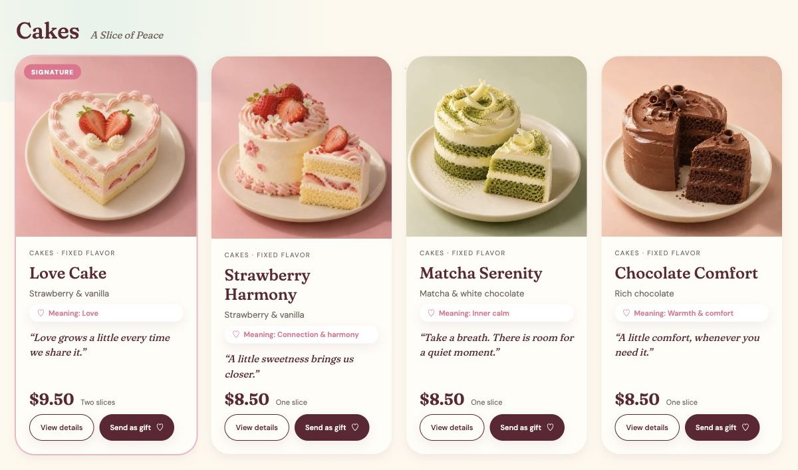
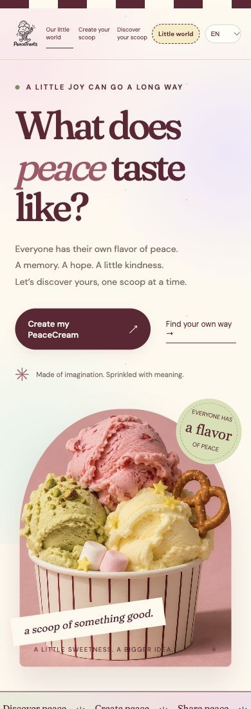

<div align="center">

# PeaceCream

### What does peace taste like?

An interactive website that turns flavors, personal values, and small moments of peace into something you can create, discover, and share.

**Designed and developed independently by [Leah Kim](https://github.com/leahkim-cpu).**

[**Live website**](https://peacecream-one.vercel.app/) · [Source code](https://github.com/leahkim-cpu/peacecream/tree/main/site) · [Run locally](#run-locally)

</div>

[](https://peacecream-one.vercel.app/)

## About the project

PeaceCream connects the joy of dessert with reflection, creativity, and human connection. Design an ice cream, choose toppings that represent values such as hope or compassion, and give your creation a personal meaning of peace.

The **Little world** directory brings the experience together: explore an illustrated World Peace Map, collect Passport stamps, save recipes, write a Time Capsule to your future self, or let a worry symbolically melt away. A separate collection offers fixed-flavor dessert gifts with personalized messages and original AI-generated product photography.

Available in **English, Japanese, and Simplified Chinese**, with responsive desktop and mobile layouts.

## A look inside

<table>
<tr>
<td width="50%"><a href="docs/screenshots/creator-desktop.jpg"></a><br><strong>Create a scoop with meaning</strong></td>
<td width="50%"><a href="docs/screenshots/world-map-desktop.jpg"></a><br><strong>Explore the World Peace Map</strong></td>
</tr>
<tr>
<td width="50%"><a href="docs/screenshots/dessert-collection-desktop.jpg"></a><br><strong>Discover thoughtful dessert gifts</strong></td>
<td width="50%" align="center"><a href="docs/screenshots/home-mobile.jpg"></a><br><strong>Made for mobile, too</strong></td>
</tr>
</table>

Real screenshots of the working website. Click any image to view it in full.

## Built with

HTML, CSS, and vanilla JavaScript · SVG maps and illustrations · Canvas image composition · Browser storage · Node.js tests

**32 automated tests** cover storage, privacy boundaries, Passport discoveries, Time Capsules, and demo rewards.

## Run locally

```sh
git clone https://github.com/leahkim-cpu/peacecream.git
cd peacecream/site
python3 -m http.server 8080
```

Open **http://localhost:8080/**. No build step or API keys are needed.

Run tests from the repository root with Node.js:

```sh
node --test site/tests/*.test.js
```

## Repository guide

- **[site/](https://github.com/leahkim-cpu/peacecream/tree/main/site)** — all website code, assets, fonts, translations, map data, tests, and development helpers.
- **[docs/screenshots/](https://github.com/leahkim-cpu/peacecream/tree/main/docs/screenshots)** — the portfolio screenshots above.

For deployment, set the static host’s **root directory to `site`**, use no build command, and serve `index.html`.

## Project status

This is a publicly deployed interactive prototype. Recipes, Passport stamps, Time Capsules, and demo rewards are stored in each visitor’s browser; they are not synchronized across devices or users. The map currently reflects stories shared within that browser. Gift checkout and reward codes are demos; no payments or deliveries are connected.

Worry text is kept only in memory. Camera photos are processed locally. Product photography was generated with AI.

Map geography: Natural Earth via world-atlas. Bundled fonts: DM Sans and Fraunces.
